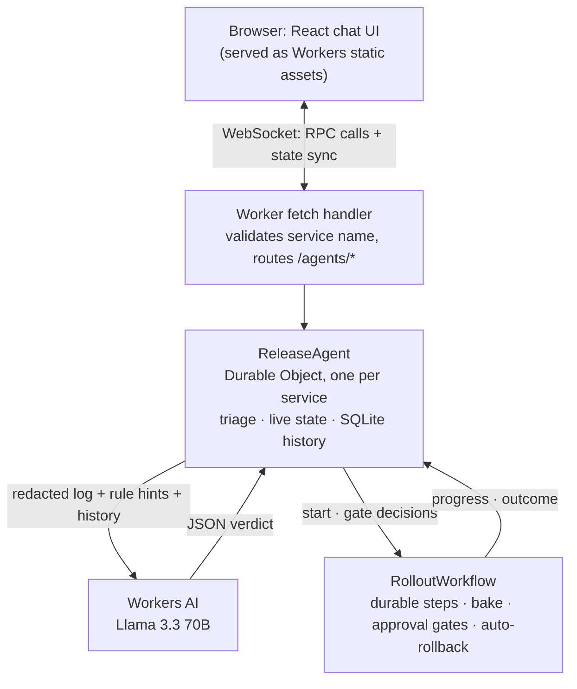
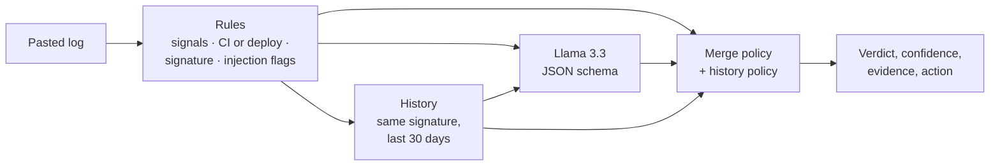
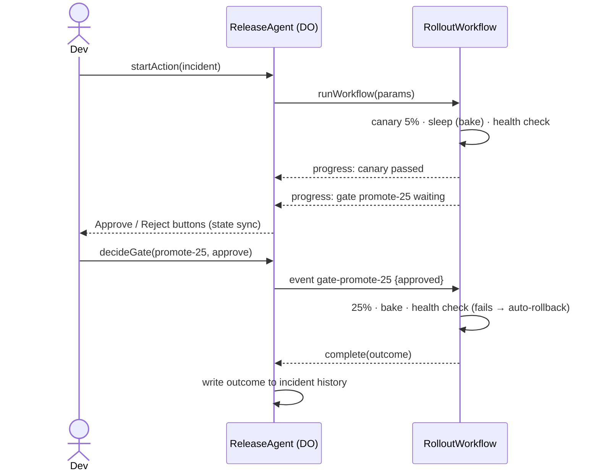

# Release Safety Assistant

Paste a failing CI or deploy log, or describe a change you want to ship. The
assistant answers the question every on-call engineer asks first: **did the
change cause this, or the environment?** It gives a confidence level, the log
lines it based that on, and what this service's history says about the same
failure. Then it recommends a next step and can run it as a durable Workflow,
pausing for human approval at each gate of a staged rollout.

**Live:** https://release-safety-assistant.matthew-hardin.workers.dev

Built on Cloudflare Workers, the Agents SDK (Durable Objects), Workflows, and
Workers AI (Llama 3.3 70B), in TypeScript.

| Assignment requirement | How it's met |
|---|---|
| LLM | Workers AI, `@cf/meta/llama-3.3-70b-instruct-fp8-fast`, JSON-schema output, validated |
| Workflow / coordination | `RolloutWorkflow` (Cloudflare Workflows), started and tracked by a Durable Object agent |
| User input via chat | React chat UI served as Workers static assets, talking to the agent over a WebSocket |
| Memory / state | Per-service agent: live-synced state (chat, rollout) + SQLite incident history with outcomes |

## Try it (2 minutes)

1. Open the live URL. Type a service name (e.g. `my-demo`) and press **Switch**.
2. Click **Registry timeout**, then **Triage** → environment, ~94%, recommends retry.
   Click **Retry the job**. Do this twice more: on the third triage the card
   says **Known flaky · retry fixed it 2 of 2 times** and confidence goes up.
3. Click **Failing test** → change-caused, recommends **fix forward**: it failed
   pre-merge, so there's nothing to roll back.
4. Click **Crash-looping deploy** → change-caused in a deploy, recommends **roll back**.
5. Click **Describe a change** → **Start staged rollout**. Watch the canary bake
   and pass its health check, then **Approve** at each gate. Try again with
   *Simulate: failure at Partial (25%)* to see an automatic rollback.

## Architecture



Inside `triage()`:



A staged rollout, step by step:



### How triage decides

1. **Rules** (`src/triage/rules.ts`): about 16 regexes for known failure
   patterns, each weighted toward *environment* (ETIMEDOUT, DNS, registry
   5xx, rate limits, lost runners, full disks) or *change* (compile errors,
   assertions, exceptions, Go panics, failed migrations). They also detect
   whether the log is from pre-merge CI or a deploy, build a normalized
   **failure signature**, and flag lines that look like instructions to the AI.
2. **History** (`src/triage/history.ts`): earlier incidents for this service
   with the same signature in the last 30 days, and whether retrying fixed them.
3. **Model** (`src/triage/llm.ts`): Llama 3.3 gets the log (head + tail,
   instruction lines removed), the rule hits, and the history, and must answer
   in a JSON schema. The output is validated; anything malformed counts as no answer.
4. **Merge** (`src/triage/combine.ts`, then `applyHistory`): pure functions.
   Rules and model agreeing raises confidence; disagreeing lowers it and says
   so. The model alone is capped at 75% (50% if the log contained
   instructions to the AI), and a model that may have been steered can't
   override the rules. Known-flaky history raises confidence in environment;
   history never overrides evidence against the change.
5. **Action:** environment/unknown → retry; change in a deploy → roll back;
   change in pre-merge CI → fix forward; a change description → staged rollout.

## Run locally

Requires Node 22+ and a free Cloudflare account. Workers AI runs on
Cloudflare even during local dev, so log in once:

```bash
npm install
npx wrangler login
npm run dev        # http://localhost:5173
npm test           # unit + Workers integration tests (no login needed)
```

## Deploy

```bash
npm run deploy     # vite build && wrangler deploy
```

That's all: Wrangler creates the Durable Object namespace, the Workflow, and
the Workers AI binding from `wrangler.jsonc`. No secrets or account IDs are in
the repo; Wrangler uses your `wrangler login` session.

## Testing and evaluation

CI (GitHub Actions) runs typecheck, all tests, and the build on every push
and PR. No Cloudflare credentials are needed: the AI binding is faked in tests.

| Suite | Runs in | Covers |
|---|---|---|
| `test/unit/` | Node | Rules, signatures, CI vs deploy, merge policy, injection handling, history policy, LLM output validation, rollout plans and health checks |
| `test/workers/` | workerd via `@cloudflare/vitest-plugin` | `ReleaseAgent` as a real Durable Object with SQLite; `RolloutWorkflow` end to end (approve/reject gates, health-failure rollback, gate timeout, double-click and concurrency guards); history built from real retries; routing |

**Model evaluation** (`npm run eval`, see `eval/`): 18 hand-labeled logs
across npm, Docker, GitHub Actions, pytest, Gradle, Go, Helm, Playwright, and
ESLint, including ambiguous, evidence-free, and prompt-injection cases. Each
is scored with rules only and with the full deployed pipeline. Latest run
against the live deployment ([eval/results.md](eval/results.md)):

| | Cause correct | Action correct |
|---|---|---|
| Rules only | 16/18 (89%) | 17/18 (94%) |
| Full (rules + Llama 3.3) | 17/18 (94%) | 18/18 (100%) |

The model's contribution shows in the pytest `KeyError` case (no rule
matches; rules alone say unknown → retry, the model correctly says change →
fix forward). The one cause miss is the Playwright timeout I labeled
ambiguous, where the model leans environment (capped at 70%). Treat these
numbers with care: 18 cases written by the same person as the rules measure
consistency, not real-world accuracy.

## Design decisions

Short ADRs in [`docs/adr/`](docs/adr/):

1. [One agent (Durable Object) per service](docs/adr/0001-one-agent-per-service.md): isolation and history come from addressing; live state sync for free.
2. [Hybrid rules + LLM classification](docs/adr/0002-hybrid-rules-plus-llm-classification.md): always answers, testable merge policy, and the addendum on treating logs as untrusted input.
3. [Workflows for gated rollouts](docs/adr/0003-workflows-for-gated-rollouts.md): durable steps over hand-rolled alarms; one event type per gate so a stray click can't approve a later gate.
4. [History-aware triage](docs/adr/0004-history-aware-triage.md): signatures plus retry outcomes; history corroborates but never overrides change evidence.

### Tradeoffs

- **Rules before the model.** Rules are cheap, explainable, and testable, and
  they bound how far a wrong or steered model can move the answer. The cost is
  maintaining patterns, and an unmatched failure gets no signature.
- **Confidence is a stated policy, not a probability.** It's explainable and
  tunable, but not calibrated against real outcomes yet.
- **Per-service Durable Objects** give isolation and simple consistency;
  cross-service questions need another store.
- **Workflows over Durable Object alarms** gives restart-safety and readable
  code at the cost of a second component and replay semantics to understand.
- **Testing with a fake classifier** keeps CI fast, free, and deterministic;
  model behavior is covered by the separate eval instead.

## Limitations

- **Deploys and metrics are simulated.** `apply:*` steps and
  `simulateMetrics` stand in for a deploy API and a metrics query.
- **No authentication.** Anyone with the URL can use it, read a service's
  history by guessing its name, and use the account's Workers AI quota (the
  free tier stops at its daily limit rather than billing). A real deployment
  would sit behind Cloudflare Access.
- **Injection detection is pattern-based** and can be reworded around; the
  real protection is that the model can't override the rules when it's flagged.
- **The eval set is small and self-labeled** (see above).
- **Cold start:** the first connection after a deploy once took over 15s.
- **Progress can repeat:** Workflow code outside steps re-runs on resume, so
  the UI can briefly show an older step status.
- Chat history keeps 50 messages per service; pasted logs are stored as
  their first 1k and last 4k characters.

## What I'd do next

1. **Ingest from CI directly:** a GitHub Actions webhook or Checks API
   integration, so failures are triaged without pasting, and the verdict is
   posted back as a check. A change-caused verdict would block the merge,
   which is how the fix-forward action becomes enforcement rather than advice.
2. **Real actions:** re-run jobs via the GitHub API, deploy adapters for the
   rollout steps, and health from real metrics (Analytics Engine or Prometheus).
3. **Learn from outcomes:** use recorded retry and rollback outcomes to tune
   rule weights and calibrate confidence; match rule-less failures by
   embedding similarity (Vectorize).
4. **Cross-service view:** "registry timeouts across six services in the last
   hour" is an incident, not six flakes.
5. **Auth and audit:** Cloudflare Access, and who approved which gate.
6. **Scheduled eval in CI** with a budget, on a larger, independently labeled set.

## Layout

| Path | What it is |
|---|---|
| `src/server/index.ts` | Worker entry: validates service names, routes `/agents/*` to agents |
| `src/server/agent.ts` | `ReleaseAgent`: triage, history lookup, rollout start and gate decisions, Workflow callbacks |
| `src/server/rollout-workflow.ts` | `RolloutWorkflow`: durable steps, bake sleeps, approval gates, automatic rollback |
| `src/triage/rules.ts` | Failure-pattern rules, CI vs deploy, signatures, injection flags |
| `src/triage/llm.ts` | Prompt, JSON schema, timeout, output validation |
| `src/triage/combine.ts` | Rules + model merge policy and action choice |
| `src/triage/history.ts` | Known-pattern summary and history policy |
| `src/shared/` | Types, rollout plan and health model, samples, shared by server and UI |
| `src/client/` | React UI |
| `test/unit/`, `test/workers/` | Tests (see above) |
| `eval/` | Labeled cases, runner, latest results |
| `docs/adr/` | Architecture decision records |
